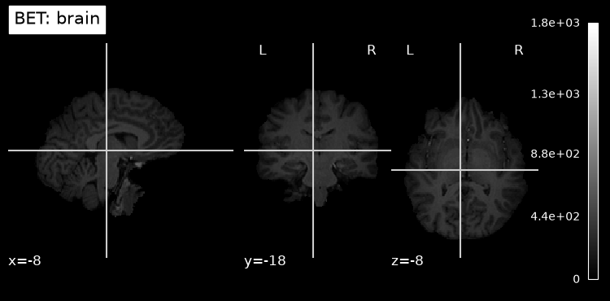
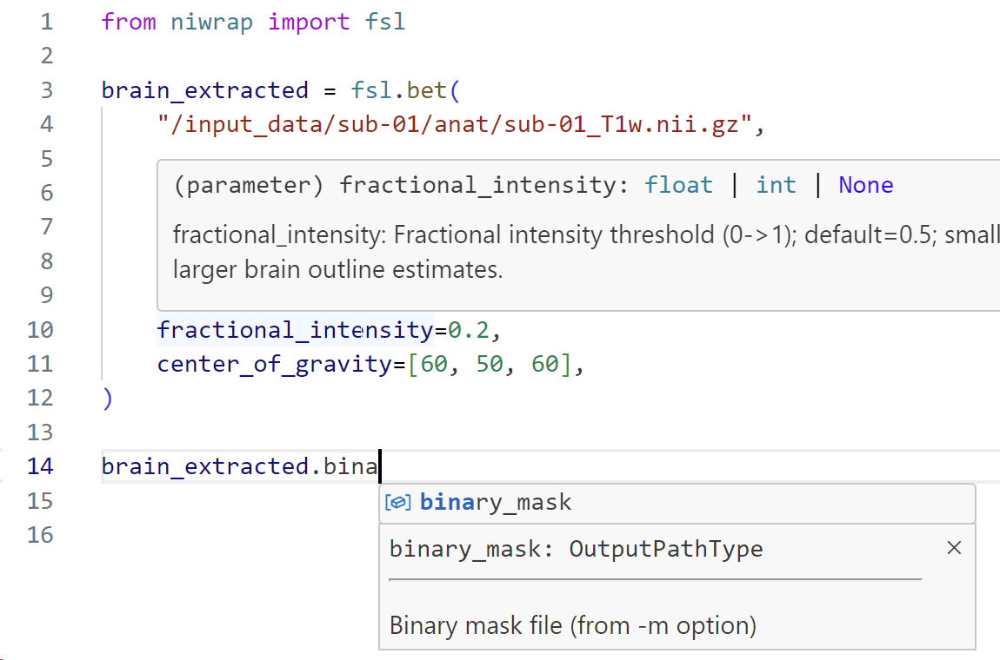
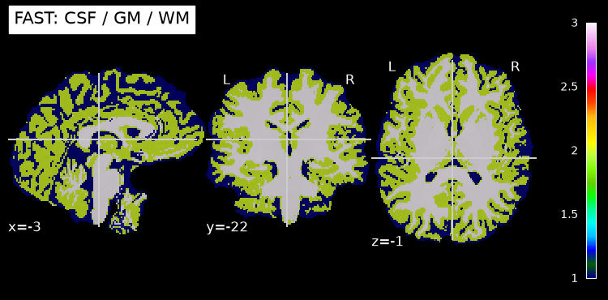
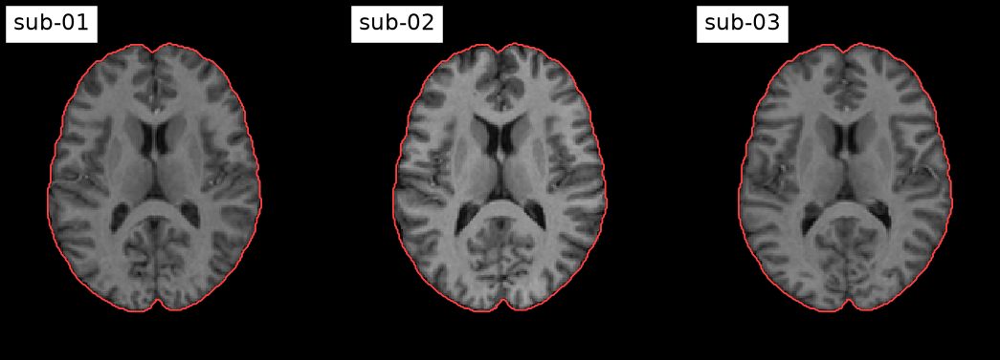
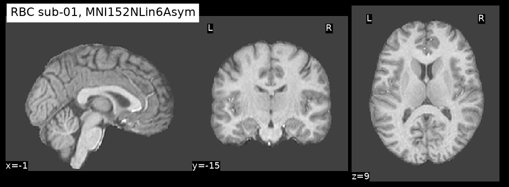

<!-- _class: lead -->
<!-- _paginate: false -->

# NiWrap hands-on

Neuroimaging command-line tools as Python functions

Open `notebooks/01_first_calls.ipynb` and run the first cell.

<!--
Ask everyone to run the first cell now. Docker problems should show up in the first 10 minutes, not at minute 40.

Quick poll: who ran the smoke test? Who has no Docker? Those people set RUNNER = "dry" (FACILITATOR.md).
-->

---

## Agenda

| Minutes | | Notebook |
|---|---|---|
| 0–10 | Why NiWrap | |
| 10–25 | First calls | 01 |
| 25–35 | Runners | 02 |
| 35–65 | Build a pipeline | 03 |
| 65–75 | Snakemake | |
| 75–83 | RBC, a real pipeline | |
| 83–90 | Questions | |

<!--
Today is about using NiWrap. Questions about writing descriptors or the compiler go to the end.
-->

---

<!-- _class: lead -->

# Why NiWrap

---

## Three tools, three conventions

```text
bet t1w_cropped.nii.gz img_bet -f 0.5 -m

N4BiasFieldCorrection --image-dimensionality 3 \
    --mask-image img_bet_mask.nii.gz \
    --input-image img_bet.nii.gz --output t1w_n4.nii.gz

fast -t 1 -o t1w t1w_n4.nii.gz
```

Positional arguments, long flags, short flags, outputs named from a prefix.
Each line needs its toolbox installed.

<!--
These are real commands from today's pipeline. bet takes input and output positionally; ANTs uses long flags; FAST names its outputs from a prefix (t1w_seg.nii.gz, t1w_pve_0.nii.gz, ...).

Ask: who has a bash script like this? Who has lost a run to a typo in a flag?
-->

---

## The same call in Python

```python
dry = niwrap.DryRunner()
fsl.bet(infile=T1W, fractional_intensity=0.4, binary_mask=True, runner=dry)
print(shlex.join(dry.last_cargs))
```

```text
bet ../data/ds000001/sub-01/anat/sub-01_T1w.nii.gz img_bet -f 0.4 -m
```

Named arguments in, the exact command out.

<!--
The function knows every bet flag, its type and its valid range. The DryRunner shows the command without running it. img_bet is bet's default output prefix.
-->

---

## What you get

- About 1,900 tools in 13 packages: FreeSurfer, AFNI, FSL, Workbench, MRtrix3, ANTs, ...
- Docs for every argument and output, in your editor
- Arguments checked before anything runs
- Each tool runs in its own container image, if you want

<!--
Counts from the niwrap README coverage table (FreeSurfer 672, AFNI 552, FSL 243, Workbench 203, MRtrix3 121, ANTs 72): binaries with a descriptor, not every flag of every binary.

The wrappers are generated from tool descriptors by the Styx compiler, which is why coverage is broad and consistent. Same API in TypeScript. Don't go deeper today.
-->

---

<!-- _class: lead -->

# First calls

`notebooks/01_first_calls.ipynb`

---

## Run BET

```python
bet = fsl.bet(infile=T1W, binary_mask=True)
```

```python
print(bet.outfile)
print(bet.binary_mask)
```



<!--
Point at the log: "Running docker: docker run ..." and "Running command: bet /styx_input/0/... img_bet -m". The second line is what ran in the container.
-->

---

## Checked before running

```python
try:
    fsl.bet(infile=T1W, fractional_intensity=40)
except niwrap.StyxValidationError as e:
    print(e)
```

```text
Parameter `fractional_intensity` must be between 0 and 1 (inclusive)
```

No container starts.

<!--
In a bash script you'd find this percent-vs-fraction mistake after the run, or never.
-->

---

## Docs in your editor



VS Code: hover and type. Jupyter: Tab to complete, Shift+Tab for docs.

**Try it (2 min):** find FAST. Which parameter names its outputs? Which output is the hard segmentation?

<!--
Screenshot from the 2024 OHBM and INCF Styx posters. Hover on a parameter shows its type and description; typing after an output object lists the output files with their descriptions. NiWrap 1.1 shows the type as float | None rather than float | int | None; otherwise identical.

Answer: out_basename; tissue_class_map (_seg.nii.gz).

Jupyter completion needs an idle kernel. VS Code (Pylance) works from the type hints even while a cell runs. In Jupyter, `fsl.bet?` prints the whole docstring.
-->

---

## Into Python

```python
if RUNNER != "dry":
    mask = nib.load(bet.binary_mask)
    voxel_ml = math.prod(mask.header.get_zooms()) / 1000
    print(f"Brain volume: {mask.get_fdata().sum() * voxel_ml:.0f} ml")
```

```text
Brain volume: 1416 ml
```

Outputs are ordinary files: nibabel, nilearn, numpy all work on them.

---

## Into another tool

```python
seg = fsl.fast(in_files=[bet.outfile], out_basename="t1w")
seg.tissue_class_map
```

Without `out_basename`, `seg.tissue_class_map` is `None`.



<!--
The out_basename gotcha returns in notebook 03 for fslreorient2std and robustfov. If an output is None, look for the parameter that names it.

FAST takes ~2 minutes. Start it and move on to Runners.
-->

---

<!-- _class: lead -->

# Runners

`notebooks/02_runners.ipynb`

---

## Same code, different execution

| Runner | Runs tools | Use on |
|---|---|---|
| `LocalRunner` (default) | installed locally | machines with FSL, ANTs, ... |
| `DockerRunner`, `PodmanRunner` | in each tool's image | laptops, workstations |
| `SingularityRunner` | in Apptainer/Singularity | HPC |
| `DryRunner` | nowhere | checking commands |

---

## Docker in one line

```python
runner = niwrap.use_docker(data_dir=WORK)
```

- FSL runs in `brainlife/fsl`, ANTs in `antsx/ants`, pulled on first use
- Each call gets a folder in `data_dir`: `<session>_<n>_<tool>/`
- `niwrap.use_singularity(...)` and `niwrap.use_podman(...)` work the same way

<!--
Show work/02/<id>_0_bet/ in the file browser. run.sh holds the exact command.

data_dir is scratch: copy what you keep (notebook uses shutil.copy2), delete the rest.
-->

---

## No Docker: dry run

```python
runner = niwrap.use_dry()
bet = fsl.bet(infile=T1W, binary_mask=True)
print(shlex.join(runner.last_cargs))
bet.outfile
```

```text
bet ../data/ds000001/sub-01/anat/sub-01_T1w.nii.gz img_bet -m
```

Commands are built and checked. No files are created.

<!--
Fallback for anyone whose Docker doesn't work today: RUNNER = "dry" at the top of each notebook.

Also handy before a long cluster job.
-->

---

## Let NiWrap pick

```python
niwrap.resolve_runner()
```

```python
runner = niwrap.use_dry() if RUNNER == "dry" else niwrap.use_auto(data_dir=WORK)
```

`use_auto()` tries Docker, Podman, Apptainer/Singularity, then local tools.
One script for laptop and cluster.

<!--
This is what every notebook's setup cell does. The Snakemake scripts later call niwrap.use_auto() too, and RBC uses the same detection order behind --runner auto.

Quieter logs: logging.getLogger(runner.logger_name).setLevel(logging.INFO). Notebook 03 sets it because ANTs registration prints thousands of lines.
-->

---

<!-- _class: lead -->

# Build a pipeline

`notebooks/03_pipeline_starter.ipynb`

<!--
35-65 min. Show the goal, then let people work and walk the room. Show the solution slides at ~60 min.
-->

---

## The goal



Three subjects in MNI152NLin2009cAsym space. Red: the template's outline.

<!--
This is the solution notebook's output. By the end of the hour every attendee with Docker has this for sub-01, most for all three.
-->

---

## Start: the Styx book's example

```python
def anatomical_preprocessing(t1w: Path) -> tuple[fsl.BetOutputs, fsl.FastOutputs]:
    reorient = fsl.fslreorient2std(input_image=t1w, output_image="t1w_reoriented.nii.gz")
    crop = fsl.robustfov(input_file=reorient.output_image, output_image="t1w_cropped.nii.gz")
    brain = fsl.bet(infile=crop.output_roi_volume, fractional_intensity=0.5, binary_mask=True)
    seg = fsl.fast(in_files=[brain.outfile], img_type=1, out_basename="t1w")
    return brain, seg
```

<!--
The book's anat_preproc, updated for niwrap 1.1: outputs must be named, and BET's -R is dropped (fails in the default FSL image: dc missing).

Step 0 runs this on sub-01, ~2 min (mostly FAST).
-->

---

## TODOs

1. N4 between BET and FAST: `ants.n4_bias_field_correction`
2. Register: `ants.ants_registration_sy_n_quick_sh`
3. Warp the segmentation: `ants.ants_apply_transforms`, `GenericLabel`
4. Collect outputs in `process_subject`
5. Loop over subjects

Run sub-01 first. Start the loop when TODO 4 works.

<!--
Per subject on a laptop: FSL steps <30 s, N4 ~5 s, FAST ~2 min, registration 2-5 min. The other two subjects take ~15 min together.

Dry-run attendees: print(shlex.join(runner.last_cargs)) after a call.

Common snags: image_dimensionality=3 missing; a plain string where N4's output helper is expected; transform order (warp before affine).
-->

---

## Solution: N4 and registration

```python
    n4 = ants.n4_bias_field_correction(
        input_image=brain.outfile,
        mask_image=brain.binary_mask,
        image_dimensionality=3,
        output=ants.n4_bias_field_correction_corrected_output_params(
            corrected_output_file_name="t1w_n4.nii.gz"
        ),
    )
```

```python
def register(t1w_brain: Path) -> ants.AntsRegistrationSyNQuickShOutputs:
    return ants.ants_registration_sy_n_quick_sh(
        dimensionality=3,
        fixed_image=TEMPLATE,
        moving_image=t1w_brain,
        output_prefix="t1w_to_template_",
    )
```

<!--
An FSL output feeds an ANTs input. Different package, different container.

The *_params helpers build nested arguments. Type ants.n4_bias_field_correction_ and autocomplete lists them.
-->

---

## Solution: one subject

```python
        transform=[
            ants.ants_apply_transforms_transform_file_name_params(xfm.output_warp),
            ants.ants_apply_transforms_transform_file_name_params(xfm.output_transform),
        ],
```

```python
def process_subject(t1w: Path) -> dict[str, Path]:
    brain, t1w_brain, seg = anatomical_preprocessing(t1w)
    xfm = register(t1w_brain)
    return {
        "desc-preproc_T1w.nii.gz": t1w_brain,
        "desc-brain_mask.nii.gz": brain.binary_mask,
        "dseg.nii.gz": seg.tissue_class_map,
        f"space-{SPACE}_desc-preproc_T1w.nii.gz": xfm.output_warped_image,
        f"space-{SPACE}_dseg.nii.gz": warp_labels(seg.tissue_class_map, xfm),
        f"from-T1w_to-{SPACE}_mode-image_xfm.mat": xfm.output_transform,
        f"from-T1w_to-{SPACE}_mode-image_xfm.nii.gz": xfm.output_warp,
    }
```

<!--
ANTs applies transforms last to first, so the warp is listed before the affine.
-->

---

## Registration threads

```python
    runner = niwrap.use_auto(
        data_dir="../work/03",
        environ={"ITK_GLOBAL_DEFAULT_NUMBER_OF_THREADS": str(os.cpu_count())},
    )
```

`antsRegistrationSyNQuick.sh` defaults to 1 thread.
On a desktop: 5 min with 1 thread, 2 min with 4.

<!--
environ goes into every container. Useful for any ITK-based tool (ANTs, c3d, greedy).
-->

---

<!-- _class: lead -->

# Snakemake

<!--
65-75 min. Demo from the repo root.
-->

---

## From `niwrap-workflow-examples`

```python
rule anatomical_preprocess:
    """Skull-strip and bias-field correct a subject's T1w image."""
    input:
        t1w=f"{bids_dir}/sub-{{subject}}/anat/sub-{{subject}}_T1w.nii.gz",
    output:
        preproc_t1w=f"{output_dir}/preprocess/sub-{{subject}}_desc-preproc_T1w.nii.gz",
    params:
        bet_fractional_intensity=config.get("bet_fractional_intensity"),
    script:
        "scripts/preprocess.py"
```

```python
niwrap.use_auto()

bet = fsl.bet(
    infile=snakemake.input.t1w,
    fractional_intensity=snakemake.params.bet_fractional_intensity,
)
```

<!--
snakemake/ is copied from github.com/styx-api/niwrap-workflow-examples (examples/snakemake-niwrap), BET -> N4 -> SyN. One fix: the scripts' `from snakemake.iocontainers import snakemake` doesn't exist in Snakemake 9.27 and crashes; Snakemake injects `snakemake` anyway.

The NiWrap code in the script is the code from the notebook. Snakemake adds file-based dependencies, re-runs only what's missing, parallel subjects, cluster submission.
-->

---

## Run it

```bash
uv run snakemake -s snakemake/Snakefile --cores 1 -n   # what would run?
uv run snakemake -s snakemake/Snakefile --cores 3      # three subjects in parallel
```

| Engine | Example in `niwrap-workflow-examples` |
|---|---|
| Snakemake, Snakebids | `snakemake-niwrap`, `snakebids-niwrap` |
| Nextflow | `nextflow-niwrap` |
| Dagster | `dagster-niwrap` |

<!--
Show -n (instant). Then start --cores 3 (4.5 min for three subjects on a 16-core desktop, longer on a laptop) or show the pre-computed derivatives/snakemake/.

Delete one subject's output and re-run: only that subject runs.

All four examples implement the same pipeline. Snakebids turns it into a BIDS app.
-->

---

<!-- _class: lead -->

# RBC

Reproducible Brain Charts preprocessing, built on NiWrap

---

## One command

```bash
uvx --from git+https://github.com/childmindresearch/rbc@9eaf3ac rbc anatomical \
    data/ds000001 -o derivatives/rbc --participant-label 01 --ants-threads 4
```



BIDS in, BIDS derivatives out. Docker by default.

<!--
Reference implementation of the RBC protocol (Shafiei et al. 2025, Neuron), previously run with C-PAC. Stages: anatomical, functional, metrics, qc, or all.

uvx gives RBC its own environment: it pins niwrap 0.9, the workshop uses 1.1.

Start it live if you like, but show pre-computed output. The anatomical stage took 38 min for one subject on a 16-core desktop (ANTs brain extraction plus a 3-stage registration).
-->

---

## Same shape as `process_subject`

```python
    reoriented_t1w = deoblique_and_reorient(in_file=in_t1w)
    extracted_t1w = ants_brain_extraction(
        in_file=reoriented_t1w.out_file,
        brain_extraction_templates=brain_extraction_templates,
    )
    segmentation = fsl_segmentation(in_file=extracted_t1w.brain)
    tissue_masks = fsl_tissue_masks(fast_result=segmentation)
    wm_bbr = fsl_wm_bbr_mask(fast_result=segmentation)
    transforms = ants_registration(
        in_file=extracted_t1w.brain,
        registration_template=registration_template,
    )
```

`rbc/workflows/anatomical.py`, logging lines omitted

<!--
Each step is a function that calls NiWrap and returns paths; the next step takes those paths. Notebook 03 plus a command-line interface.

Open src/rbc/core/anatomical/segmentation.py to show one step: fsl_segmentation is a single fsl.fast call.

RBC's --runner auto uses the same Docker, Podman, Apptainer, local order as niwrap.use_auto(). RBC is on niwrap 0.9, where nested-argument helpers have no _params suffix.
-->

---

## Questions

- [niwrap.dev](https://niwrap.dev), and the [Styx book](https://niwrap.dev/styxbook/)
- Tool coverage: [github.com/styx-api/niwrap](https://github.com/styx-api/niwrap)
- Workflow engines: [github.com/styx-api/niwrap-workflow-examples](https://github.com/styx-api/niwrap-workflow-examples)
- RBC: [github.com/childmindresearch/rbc](https://github.com/childmindresearch/rbc)
- Missing a tool or flag? Open an issue on the niwrap repo.

<!--
Common questions:
- Is tool X covered? Check the coverage table, or `from niwrap import <package>` and autocomplete.
- Clusters? niwrap.use_singularity(); images are converted from Docker Hub on first use.
- Different image version? use_docker(image_overrides={"brainlife/fsl:6.0.4-patched2": "..."}).
- vs. Nipype? Nipype interfaces are hand-written and tied to its workflow engine. NiWrap wrappers are generated for many more tools and are plain functions you can use with any engine, or none.
-->
